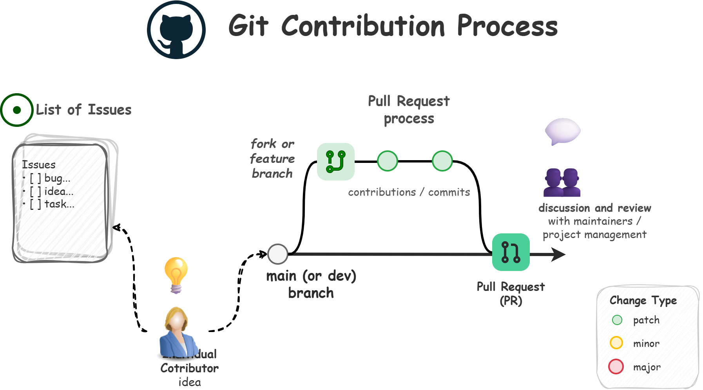
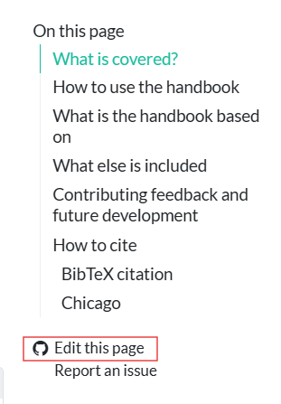

Welcome!
Thank you for your interest to contribute to this handbook.

Contributions can range from correcting a broken link to proposing a new chapter or methodological approach.

On this page, we go through the overall process of contributing, as well as how project managers / maintainers will interact with you, depending on what you're doing.

# The basic contribution process

Akin to other [open source projects](https://book.the-turing-way.org/community-handbook/contributing/#ch-contributing-pull-request), we adopt a simple contribution process.
@fig-contribution-process showcases a visual overview, with the detail outlined below.

{#fig-contribution-process fig-alt="For most ideas or non-trivial contributions, first check existing issues (and create one if needed), and then draft a feature branch and submit a Pull Request to merge the change back in. For trivial processes, feel free to submit a Pull Request directly." fig-align="center" width="80%"}

## Step 0: Make the change directly (for trivial changes)

Before starting out, think through the scale of the change you see needing to be made.
If you see a trivial issue but one that would help (say a **spelling mistake**, a **broken link**, a **formatting issues**, or something else **non substantive**) – feel free to just submit a Pull Request directly!

::: callout-note
### We want simple changes to be simple to make!

Small changes are trivial to make, and maintainers / project managers of the handbook will merge them in quickly.
:::

::: callout-tip
### Cool, how do I do this?

See [Step 2](/about/contributing.qmd#step-2-create-a-feature-branch-or-a-personal-fork-to-host-the-changes) for more details.
:::

## Step 1: Start with an issue

Before making any changes, its a great idea to review open (and older closed) issues to see whether the topic has already been raised, discussed, is in progress or was closed.
If a relevant issue already exists, add any further information or participate in the existing discussion rather than creating a duplicate.

If you create a new issue, explain the change or question as clearly as possible and include relevant links, references, examples or supporting material.

::: callout-tip
## We encourage you to participate directly!

Our issue templates will ask whether you are just raising the issue for our awareness or if you want to participate in drafting it yourself.
If you are up for it, our maintainers will assign the issue to you directly after helping validate whether the idea would be accepted!
If you are not, keep an eye on the issue you submitted.
While we appreciate you raising issues, the Individual Contributor that eventually works on the idea you raised may ping you with questions or follow ups.

Note that if your idea involves a considerable change and would require collaboration with other experts or their review before merging, our maintainers / project managers may see your idea as something that should be done as a Task Team Workstream.
In this case, we will invite you to join the team!
:::

## Step 2: Create a 'feature' branch or a personal fork to host the changes

There are many ways to do this, but the simplest way is to use the `Edit this page` link (which you will see at the bottom of the table of contents on each page).
@fig-edit-this-page shows what this looks like.

{#fig-edit-this-page fig-align="center" width="30%"}

::: callout-tip
## What you do depends on what rights you have

- If you've never contributed before and have no default rights to the main repository, GitHub will create a fork in your personal name space.
  You can make any changes you want there and merge them in when you are ready.

- If you are a member of the team in any way, you may be able to create a branch within the main repository (called a 'feature' branch as it includes the feature you are making).

  - If you are a member of a workstream, you may create a 'feature' branch from the main `development` branch your team is working on as it may be a while before that `development` branch is merged into `main` and thus the content is released.
:::

### Tips on making changes and describing them

::: callout-tip
## Style consistency matters

When you are making changes, keep the [style guide](/about/style-guide.qmd) in mind.
Its always easier to write in a way that is consistent with other content rather than needing to edit it later (maintainers / project managers will ask you to make style changes if needed).
:::

Draft the proposed changes in your branch / fork.
You can also open a Pull Request before the work is complete if you want, however please keep it in draft status until it is ready for review.

Where possible:

- keep each pull request focused on the issue it is intended to address;
- link the pull request to the relevant issue;
- explain what has changed and why;
- identify any sections that require particular attention from reviewers; and
- avoid including unrelated changes in the same pull request.

::: callout-tip
## Update the last updated date

Many handbook pages contain a hard coded `date-modified` value.
See the guidance on /about/style-guide.qmd#metadata.

If you are suggesting an edit to a page and find a hard coded `date-modified` value, replace it with `last-modified`.

For example:

``` yml
--- 
title: "page title"
date: "2024-05-08" 
date-modified: "2025-10-08" # UPDATE THIS
---
```

Change to:

``` yml
---
title: "page title"
date: "2024-05-08" 
date-modified: last-modified
---
```
:::

## Step 3: Coordinate review where needed

If your changes are consequential, it is best to coordinate the review of your content with an expert.

Some experts in our discipline however do not regularly use GitHub, hence you can make the draft available in another format, such as [PDF](https://quarto.org/docs/reference/formats/pdf.html) or [Microsoft Word](https://quarto.org/docs/reference/formats/docx.html).

For example, the page metadata can be configured to render both formats:

``` yaml
---
title: "Article title"
date: "YYYY-MM-DD"
date-modified: last-modified
format:
  pdf:
    documentclass: article
  docx:
    toc: true
---
```

This allows an offline copy to be shared with reviewers.
Any comments or edits made outside GitHub will need to be incorporated back into the relevant branch or fork before the pull request can be merged.

## Step 4: Submit the pull request for review

When your change is ready for maintainers / project managers to review, submit the Pull Request (or remove the draft status if you have been working on a draft).

In the pull request description:

- link to the relevant issue;
- summarise the changes made;
- note any supporting evidence or consultation;
- identify any outstanding questions; and
- confirm the review or approval route agreed through the issue.

Project Maintainers / Project Managers will support the contribution through the remainder of the process and will merge your change in when they see it as ready.
You may be asked to make further revisions before the changes are approved and merged.

# Annex: What to expect of the interaction process?

You will see a few structural things in your efforts to contribute.

## Semantic versioning

We use [semantic versioning](https://semver.org/) to guide how changes to the handbook are classified.

| Level | Examples | Default route | Review expectation |
|:-----------------|:------------------|:-----------------|:-----------------|
| [**PATCH**](https://github.com/UN-Task-Team-for-Scanner-Data/cpi-new-data-sources-handbook/issues?q=state%3Aopen%20label%3AMAJOR){.highlight-patch} | Spelling, links, formatting, bibliography and other non substantive corrections | Direct Pull Request | Typically merged directly by Maintainers / Project Managers |
| [**MINOR**](https://github.com/UN-Task-Team-for-Scanner-Data/cpi-new-data-sources-handbook/issues?q=state%3Aopen%20label%3AMINOR){.highlight-minor} | Case study, expanded example, factual clarification, evidence or code revision that does not change the overall scope | Issue on the topic followed by a pull request | Relevant peer review by other contributors with the same expertise and approval by maintainers / project managers. |
| [**MAJOR**](https://github.com/UN-Task-Team-for-Scanner-Data/cpi-new-data-sources-handbook/issues?q=state%3Aopen%20label%3APATCH){.highlight-major} | New chapter, substantial methodological change, new data source, major restructuring or new training module | Issue on the topic that may be followed by by a Task Team workstream or even steering committee participation. | Detailed review by other experts with the expertise. Likely collaboration with multiple other contributors is possible through a workstream. |

: Categories of contribution {#tbl-contribution-categories .striped .hover tbl-colwidths="[15,30,25,30]"}

## Issue templates

There are several issue types we may use to classify the content.

| Issue template | When to use it |
|:-----------------------|:------------------------------------------|
| **Correction Request ([PATCH]{.highlight-patch})** | Spelling mistakes, broken links, formatting problems, citation updates and other non substantive corrections |
| **Content Enhancement ([MINOR]{.highlight-minor})** | Additional examples, case studies, explanations, evidence, resources or code that do not change the overall scope of the handbook |
| **Handbook Change Proposal ([MAJOR]{.highlight-major})** | New methodology, a new chapter, substantial restructuring, a new data source or changes to existing recommendations |
| **Discussion / Guidance Request** | Questions, early ideas or proposals that require discussion before the appropriate route can be determined |


: Issue templates {#tbl-issue-templates .striped .hover}

