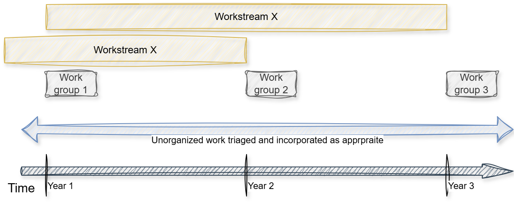

# How we work

## Principles

::: callout-important
**Open by default**

Proposals, discussion, source files and contribution history are visible wherever licensing, confidentiality and accessibility permit.
This way we are transparent and earn or retain the trust of the wider community (who can thus more readily use our content) and make it attractive for individuals to contribute.

**Easy to contribute**

We make the process of contributing simple, enabling everyone from beginners to experts to contribute to our content

**Authority is explicit**

Development content, the living handbook, formal releases and any endorsed edition is made clear.

**Proportionate assurance**

Review and approval effort should reflect the significance and risk of the change.

**Inclusive evidence**

Review should seek views and include the needs of countries at different stages of adopting new data sources.

**Reproducible and maintainable**

Content, code and publication processes should minimize single-person dependencies and retain an auditable history.

**Coherent products**

Handbook changes should trigger consideration of related code, training and catalogue content.
:::

## How work is done

Work within the Task Team is either organized into groups each around a common theme or purpose, or is left unorganized.

**Organized work** is typically time or scope bound activity aimed at achieving something specific.
For instance:

- **Workstreams** are formed and staffed with contributors to develop a set of products or outputs.
  A workstream may persist over several years and may even expand scope.
  The goals are clearly stated so that contributors know towards what they are focusing on each year.

  > The **steering group** can be considered a long lasting group that sets the overall direction with regular goals.
  >
  > Another example is Workstream 5 (or the FAIR / Reproducibility) workstream.
  > It launched in late 2024 and has gone through two annual cycles with specific scope and goals outlined each year.

- **Work groups** are short lived groups that are brought together to achieve something.
  Each group could be small (two Individual Contributors (ICs)) or larger (several ICs and several experts consulted on what is being developed).
  In either case, their contributions are typically made as several [MINOR]{.highlight-minor} or [MAJOR]{.highlight-major} updates to the content.[^1]

  > Every year following a Price Statistics conference, a project manager on the Task Team forms a work group to review and integrate new material into the existing products

[^1]: See [contributing process](/about/contributing.qmd#semantic-versioning) for more detail on types of changes.

Contributions to Task Team products by **submitting issues** or **Pull Requests** is left as **unorganized work**.
These contributions can come from periodic or active contributors, or from any other group (even from Steering Group members) and are an avenue to improve our outputs!
Unorganized requests are triaged and handled appropriately (see the [contributing process](/about/contributing.qmd) for more on this process).

@fig-org-bodies-timeline shows how these bodies co-exists.

{#fig-org-bodies-timeline fig-align="center" width="100%"}

## Project management meets GitHub

We use GitHub to track all work activity:

- All activity is tracked on GitHub as issues and PRs.
  See the [contributing process](/about/contributing.qmd) for more detail on the process.

- GitHub projects are used to project manage specific workstreams or group.
  A project charter that outlines the scope for the year (if its organized) is made to identify why something is in scope.

# Roles and responsibilities

## RACI

We outlined roles and responsibilities in RACI format to clarify who does what.

| Activity | Project Managers | Active Contributors | Steering committee | Expert Roster | Casual contributors |
|------------|------------|------------|------------|------------|------------|
| Maintaining contribution process and guardrails | Responsible | Consulted through PR process | Accountable for success |  |  |
| Triage an issue or basic PR | Responsible |  |  |  |  |
| ... |  |  |  |  |  |

: RACI matrix

- *Responsible (R) —* Those who complete the task.
- *Accountable* (A) — The one ultimately answerable for the correct completion of the deliverable or task, ensuring the prerequisites of the task are met, and delegating the work to those *responsible*.
- *Consulted* (C) — Those whose opinions are sought, such as subject-matter experts, and with whom there is two-way communication.
- *Informed* (I) — Those who are kept up-to-date on progress, often only on completion of the task or deliverable, and with whom there is just one-way communication.

### Collaboration within the community

::: callout-note
## Do we need a slack/related?

TBC - for offline async conversations between the community
:::

## Archiving releases to Zenodo

We archive selected releases of the repository in Zenodo.

### How often do we make releases?

We have two ways to organize releases:

- If there has been a moderate to large amount of smaller fixes – once a year we will do a major release that will create a new Zenodo DOI and a new version of the handbook.
  We will report the differences of the release at a price statistics conference (there is typically a conference every summer) to showcase transparently to the broader community what has changed.

- If there are major changes that are made or a large amount of minor changes also accumulate – we may make several releases outside of the annual cycle.

### How do we make a release?

We [create a new GitHub release](https://docs.github.com/en/repositories/releasing-projects-on-github/managing-releases-in-a-repository) for the project, which [archives a copy of that release in Zenodo](https://help.zenodo.org/docs/github/archive-software/github-upload/).
Zenodo mints a new DOI for that release (which is a child of the parent DOI), which we integrate into the repository.
This is why you can site a specific version or the master record when you reference the handbook.

::: callout-tip
## Live site is leading the release DOI slightly

The live handbook may therefore include changes made since the latest archived and citable version.
Users who need a fixed version for citation should use the relevant archived release.
:::

You can view [previous handbook releases](https://github.com/UN-Task-Team-for-Scanner-Data/cpi-new-data-sources-handbook/releases).

### Who makes a release?

The steering committee coordinates all releases.