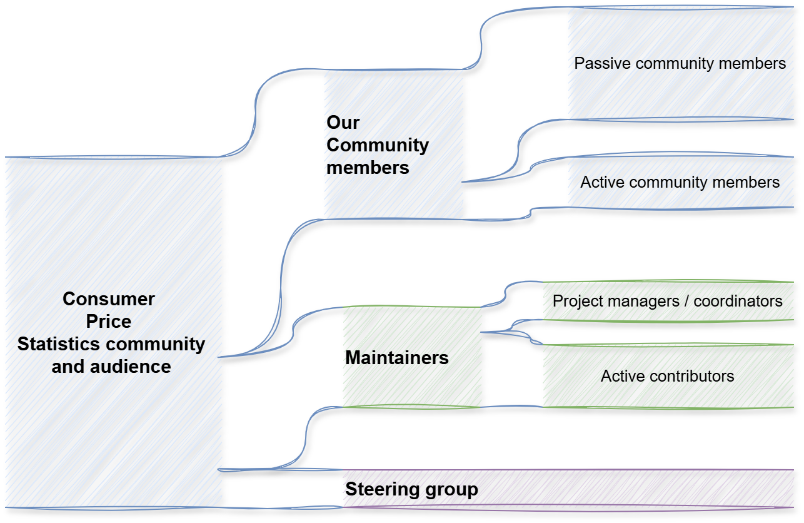

# What is governance to us?

Who are the UN Task Team on Scanner data?
We are members of the price statistics community, working to simplify the work of the broader community to adopt new (i.e. alternative) data sources.
How we govern our group is key to ensure we add value and use each others' time effectively.

::: {.callout-important appearance="simple"}
We see **governance** as the processes and norms used by a group to deliver useful products and services to a broader community, by means of fostering direction and focus of enthusiastic contributors towards shared goals.
:::

Breaking that out a little, we see the key aspects as:

- **Developing value adding products** – with the goal to make it easier for price statisticians to understand, research, or implement alternative data to enhance their national statistical outputs.

- Helping focus the **best and brightest** in our community **to contribute** and **thus** **help the community itself** – as our community can only learn from each other.

- Working to instill **transparency in the direction and the strategies** used – as a means of validating that products created or maintained are adding value, the work being done is headed in the right direction, and making it easy to engage and participate

## Overview of the three levels

We break down the overall consumer price statistics community into three broad levels to specify how Task Team contributors interact with the wider community:

- The **casual and passive** members of the price statistics community – includes everyone who work in the discipline of price statistics that passively consume our products (if they are aware of them).
  This is the main group we are trying to support.
  Some passive members of the community may engage with us casually, either on their own interest or responding to our consultations.

  > We both welcome contributions from this group and at time seek to engage this group (such as to validate some of our more nuanced content)

- **Active or contributing** members – are the **maintainers** and **contributors** to our content.
  This group either creates new content and products or sustains them to ensure they stay relevant and continue to add value.

- The **steering group** – is a nominated volunteer group that sets strategic Task Team level direction, evaluate gaps and launch workstreams to address them, advocates for the group, and sets norms that help the broader community.

@fig-stakeholder-sankey showcases this breakdown visually.

::: {#fig-stakeholder-sankey fig-align="center"}


<!-- NOTE - Mermaid diagram below is commented out as mermaid v11.15.0+ is needed to render it properly -->

````{=html}
<!-- ```{mermaid}
---
config:
  sankey:
    showValues: false
    labelStyle: outlined
    nodeAlignment: justify
    nodePadding: 35
    nodeWidth: 35
    nodeColors:
      Consumer Price Statistics Community: "#4e79a7"
      Casual and passive community members: "#42c9cb"
      Active or contributing community members: "#16d43f"
      Steering committee: "#f329ba"
      Passive content consumers: "#b2abb0"
      Active contributors: "#048308"
---
sankey
%% source,target,value
Consumer Price Statistics Community,Casual and passive community members,70
Consumer Price Statistics Community,Active or contributing community members,25

Casual and passive community members,Passive content consumers,60
Casual and passive community members,Periodic contributors,10

Active or contributing community members,Project managers or coordinators,5
Active or contributing community members,Active contributors,20

Consumer Price Statistics Community,Steering committee,5
``` -->
````

How the overall consumer price statistics community breaks out into various groups.
:::

# Level-by-level deep dive

## The casual and passive members

The broader community is made up of all members of the discipline, whether they work for the National Statistical Office producing consumer price statistics, a central bank that leverages these outputs, an academic or researcher, or anyone else.
This community can be broken broken up into two sub-groups.

### Passive community members

Passive community members consume outputs created by the Task Team, but do not typically interact.
They may not even be aware of the material – which is part of our advocacy efforts.

For those who are aware, they may read and even use our content without interacting with us.
We seek to interact with this group periodically (such as to survey them or engage them directly during price statistics conferences).

### Casual (or one-off) contributors

Passive community members who see issues and want to participate periodically, are encouraged to participate and contribute to our content directly.
They may flag issues (whether trivial like spelling mistakes or more consequential such as missing content), and may participate in drafting content directly.
The most experienced ones of this group we try to encourage to become regular contributors (either on their own or by becoming members of the Task Team).

We periodically engage with experts in this community to validate nuanced or challenging aspects.
For instance the most experienced price index experts may not actively contribute to our content directly, but we try to engage with them to ensure that our content provides grounded and trustworthy recommendations.

## Active or contributing members

Those who seek to actively participate in our content tend to do so more regularly and are granted rights to our repositories to support the work.

### Active contributors

Contributors to our content can be either:

- **Individual contributors (ICs)** working on their own (or in a self-organized fashion with other ICs) to develop or improve content.
  For instance they raised ideas through the contributing process and got a green light to develop material.
  They may be **regular or semi-regular contributors**.

  > As our projects are fundamentally **open-source community driven projects**, we welcome ideas for contributions!

- Individual contributors working with others in a **workstream** launched by the steering group to **address a specific need** or **create a specific product/output**.
  ICs are typically recruited to join a workstream based on their competencies and experiences in their full time job.

  > This group is the core of regular contributors on the Task Team, as most contributions and the majority of outputs developed by the Task Team have been made by this group!

::: callout-note
Depending on bandwidth and skill sets of IC volunteers, the Steering Group may coordinate the hiring of consultants as ICs for specific tasks.
:::

### Project Managers or coordinators

Managing contributions and organizing workstreams is a key activity that ensures that community contribution are triaged and content is created in alignment with stated goals.
There are two sub-types possible:

- Maintainers – help triage various activities (such as Pull Requests or Issues – see [contributing process](/about/contributing.qmd) for more details).
  This indispensable group helps make sure materials are sustained and enhanced lightly over time.

  > Maintainers have rights to approve PRs or to assign issues or PRs to other ICs / Steering committee to weigh in.

- Project Managers (i.e. Workstream leads) – help lead individual workstreams to ensure that the goals of that workstream stays on track.

  > Workstream leads also have the right to approve PRs, and typically weight in on issues and discussions.

## Steering Committee

Finally, the steering committee is a body that meets regularly to set direction, plan each year, and ensure that norms and processes are followed.

The steering committee is made up of workstream leads and is supported by the UN Secretariat and the UN Regional Hub in Brazil (IBGE).

> The steering group is fundamentally accountable for the quality and trustworthiness of the materials/products created by the whole group.
> They have owner role on Task Team products.
